# Knife models (v2)

The game ships 12 knives, each a distinct CS2 type under its CS2 name: Karambit,
Butterfly Knife, M9 Bayonet, Talon Knife, Skeleton Knife, Bayonet, Flip Knife,
Stiletto Knife, Huntsman Knife, Bowie Knife, Gut Knife and Shadow Daggers
(`src/combat/knives.ts`). Their models are in `public/knives/<id>.glb`. The
eight retired types (falchion, navaja, ursus, classic, paracord, survival,
nomad, kukri) were dropped from the loadout as near duplicates; their builders
and notes below are kept and still build by id, and the screenshots further
down still show all 20.

## Accuracy update (2026-10-12)

The regenerated twelve-knife set is now integrated in `public/knives`, including
the corrected Butterfly. The preceding runtime set remains in
`.blender-tmp/knife-regeneration/before`; the latest packed set is in
`.blender-tmp/knife-accuracy-pass/packed`. Total payload is 14,423,940 bytes,
346,384 bytes above the preceding runtime set, with the original per-file budgets.

The Butterfly's angular dark marks were a topology defect, not a colour-bake
defect. Subdividing Boolean-cut n-gons before triangulation filled eight of the
ten vent centres with overlapping faces. Triangulating first keeps every hole
open; curve-appropriate edge spacing keeps the LOD0 below 15,000 triangles.
The asset tests ray-test all ten vent centres at both LODs. The curved guard
below the bite-handle pivot is also rebuilt from the visible reference.

The corrected set passes the 4,891-frame grip/wrist sweep with unchanged limits.
The in-game Credits tab and `CREDITS.md` identify Counter-Strike 2 and Valve as
visual inspiration, with no affiliation or endorsement implied. No Valve mesh
or texture is shipped.

Current reference comparison: `.artifacts/knife-accuracy-review/index.html`.
This is a closer reconstruction, not a 1:1 certification: single-view outline
overlap does not establish material accuracy or unseen geometry.

## Regeneration candidates (2026-10-10, historical)

The requested per-knife reconstruction is staged in
`.blender-tmp/knife-regeneration/packed`, with the preceding runtime files in
`before` and raw bakes in `candidate`. These were not integrated at that stage;
the accuracy update above records their subsequent integration.

The candidates rebuild Karambit's ring housing and finger reliefs; Butterfly's
perforated handles and inlays; both bayonet grip grooves; Flip's serrations and
channels; Stiletto's quillons and button; Gut's hook and finger relief; Talon's
holes, rivets and ivory transitions; Skeleton's one-piece ring and tape overlaps;
Huntsman's fuller and grip; Bowie's handle and pommel; and the dagger frames.

The staged set passed 130 asset checks and a 4,891-frame grip/wrist sweep before
the final Butterfly bake diagnostic. Those checks establish mechanical validity,
not visual acceptance. The candidates still fell short of the CS2 references.
Butterfly had unresolved angular dark marks around its handle details; the
reference review also exposes proportion, bevel and material gaps elsewhere.
Do not promote this set on the basis of the automated checks alone.

Review: `.artifacts/knife-regeneration-review/index.html`. The most recent
Butterfly diagnostic is `.artifacts/knife-regeneration-butterfly-check`.
The builder validates mesh data before UV generation and baking after an exporter
warning showed that a malformed Butterfly face could otherwise be repaired only
after the texture bake. That removed the warning but did not resolve the visual
artifact. The attempted curvature-wear workaround was reverted. The later
triangulation-order correction above resolved the blocked vents and dark marks.

## Material realism pass (2026-10-10)

The later dark-flat/bright-grind follow-up was rejected as visually worse and
rolled back, including its bake settings. At that point the 24 runtime assets were restored
byte-for-byte from `.blender-tmp/knife-reflection-pass/before`. This preceding
version is a restored baseline, not an approved realism target. Future material
changes need an in-game reference comparison on one knife before a full-set bake.

All twelve knives retain the preceding material bake, with geometry, camera
poses and animation sockets unchanged from the photo-driven refinement.

- Steel combines existing CC0 Metal009 roughness and Scratches005 inputs with
  directional grain. The scan range is remapped before baking.
- Grinds use a restrained colour transition and roughness change from the flats.
- Curvature masks place wear on raised edges and darker, rougher detail in
  recesses. Metallic fittings also use the existing Metal027 roughness scan.
- G10 grips retain the preceding crossed pattern and fibres. Wood, ivory, tape
  and rubber retain their distinct material patterns.
- Custom blade finishes now retain bounded baked roughness variation alongside
  their own colour and gloss. Patterned handles retain their roughness maps too.
  The material cache includes the source roughness map, preventing different
  source surfaces from incorrectly sharing one finish material.

The reused ambientCG inputs are listed in `src/credits.ts` and `CREDITS.md`.
They are bake inputs only; no Valve textures or new runtime texture slots are
introduced. That restored 24-file baseline totalled 14,077,556 bytes. Each file remained within
the existing budget. Geometry, animation sockets and draw counts are unchanged.
The knife optimizer again uses its preceding compression settings; the generic
opt-in lossless encoding utility remains available but is not enabled for knives.

`tools/qa/knife-material-check.mjs` creates identical-camera, identical-lighting
before/after views of the complete knife, blade and handle, with nonblank-pixel
checks and assertions that geometry and draw counts do not change. The local
review is `.artifacts/knife-material-review/index.html`. The rejected follow-up
is retained separately in `.artifacts/knife-realism-review` for comparison only.
Set `KNIFE_ASSET_DIR` to compare unpublished packed candidates, and
`KNIFE_OUTPUT_DIR` when running `optimize_knives.ts` to stage outputs there.
All 23 finish variants were compiled and rendered on the GPU without errors.
Asset tests measure the 10th-to-90th percentile roughness range at used blade
UVs, excluding empty atlas padding. An encoding regression covers the optional
lossless utility and the unchanged default compression path.

This pass targets material readability and variation. It does not claim an exact
CS2 texture match, nor change the previously measured silhouette scores.

## Photo-driven refinement (2026-10-10)

The chosen target is to recreate the visible appearance from captures, not port
Valve's models. All twelve now have a reproducible photo-comparison workflow:
`tools/qa/knife-photo-match.mjs` captures the actual rendered model, fits a view
to the reference's alpha silhouette, and produces a reference/render/difference
panel plus full-size image links. It rejects reversed blade orientation and
cropped views. Shipped captures retain the assets' authored normals.

The fitter measures only single-view silhouette intersection-over-union (IoU).
It does not score lighting, material accuracy or hidden surfaces, and its fitted
camera is an estimate. It is not a 1:1 certification or a substitute for additional
reference views. Shadow Daggers uses one connected reference component for the
single-dagger comparison; the in-game pair remains unchanged.

Measured before/after outline overlap with the same workflow:

| knife | before | accepted result |
|---|---:|---:|
| Karambit | 65.1% | 75.0% |
| Butterfly | 77.5% | 82.7% |
| M9 Bayonet | 79.4% | 81.7% |
| Talon | 73.9% | 77.8% |
| Skeleton | 83.9% | 90.1% |
| Bayonet | 85.2% | 89.9% |
| Flip | 75.7% | 75.7% |
| Stiletto | 88.0% | 88.0% |
| Huntsman | 80.6% | 85.2% |
| Bowie | 78.1% | 78.1% |
| Gut | 78.2% | 81.8% |
| Shadow Daggers | 47.1% | 65.7% |

`tools/blender/knives/photo_fits.json` stores the accepted bounded proportion
adjustments. `apply_photo_fit()` applies them once to the original builder
geometry, sockets and pivots before export, with continuous blending around the
guard and protected circular finger openings. Fits that broke folding clearance
were constrained. Flip, Stiletto and Bowie proportion changes that did not improve
the exported comparison were rejected; those knives retain identity fit inputs.

All knives receive the rebaked material treatment: spatial steel colour/roughness
variation and finer, less striped wood grain. The Gut hook moved toward the tip
after the photo comparison exposed its incorrect placement. Butterfly, Huntsman
and Gut have measured finger overrides; the tuner can check multiple phases and
sweep the full motion before accepting a result.

The final 24 GLBs total 12,693,940 bytes and retain the original per-file budgets.
The full 4,891-frame grip/wrist sweep passes without relaxed limits. The current
pinned socket/dimension values are in `tools/assets/knives.test.ts`; the tables
below describe the preceding full-set rebuild and are historical.

Private review output is in `.artifacts/knife-photo-review/after/index.html`, with
the baseline under `before/`. This ignored directory contains reference images
for comparison, not runtime assets. Do not include it in a deployment upload.
Only our own geometry and baked textures are in `public/knives`.

```bash
# PLAYWRIGHT_MODULE, CHROME and LOCAL_IP may be needed for the local browser
node tools/qa/knife-photo-match.mjs http://localhost:5191 <reference-directory> .artifacts/knife-photo-review/after
# --fit-shape proposes bounded inputs; physical tests must approve them before use
```

## Earlier full-set rebuild (2026-10-10)

All twelve shipped knives now use the rebuilt geometry and rebaked materials,
not just the earlier Karambit detail pass. This is an original, reference-driven
rebuild; it is not a verified 1:1 reproduction of Valve's assets.

| knife | principal changes |
|---|---|
| Karambit | longer, wider hooked blade; raised thumb ridges; sculpted grip and slim ring |
| Butterfly | curved, subdivided handle rails; inset panels; matching blade curvature |
| M9 Bayonet | broader clipped blade; larger saw teeth; physical grip ribs; smaller muzzle ring |
| Talon | fixed blade, no folding pivot; three blade holes; segmented curved ivory scales and brass rivets |
| Skeleton | finger ring moved to the front; longer tapered blade with holes; full wrapped grip |
| Bayonet | longer plain blade and fuller; separate plain guard; ribbed olive grip |
| Flip | swept blade tip; curved olive scales with recessed flutes; retained folding clearance |
| Stiletto | slim double-edged central-ridge blade; shaped wood scales and additional rivet |
| Huntsman | angular point; scalloped spine cuts; contoured black scales and shaped guard |
| Bowie | larger clipped blade and fuller; olive scales; steel fittings instead of wood/brass |
| Gut | broad hooked blade; curved wood scales and exposed tang instead of a generic rubber grip |
| Shadow Daggers | broad double-edged blades; perforated metal T-handles instead of solid rubber bars |

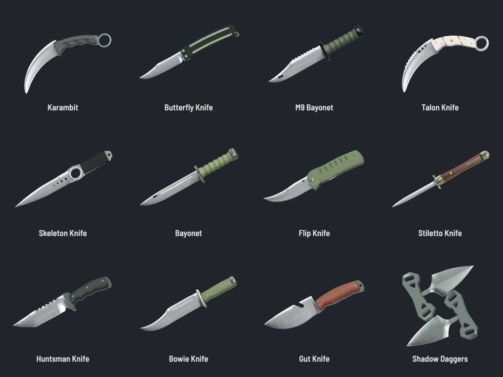

`/tools/knife-gallery.html` displays the real GLBs, using LOD1 by default to keep
the all-model view light. `?lod=0` selects the first-person assets. Shadow Daggers
appear as a pair. The gallery no longer uses procedural placeholders.

Both LODs remain inside the existing budgets: LOD0 <= 15,000 triangles / 1.5 MiB,
LOD1 <= 400 KiB and below half the LOD0 triangles. The complete 24-file set is
12,369,420 bytes. All 116 asset checks and 4,891 live grip/wrist samples pass.
The Gut index curl was refitted to the new handle. Grip containment now rejects
points outside each material surface's bounds, with tests for both the false
positive case and real solid-mesh penetration; no clearance limit was relaxed.

Official inventory renders for all twelve knives were captured with
`tools/qa/knife-reference-check.mjs` into temporary storage. The tool preserves
the original GLBs and reuses cached references. No Valve geometry or textures
were added to the runtime assets. The source views use different cameras, so
the comparisons are qualitative, not a numeric 1:1 certification.

Remaining scope: more exact material response and camera-aligned shape matching;
the remote-player path still uses its hardcoded procedural Bayonet and does not
yet transmit/display the selected knife. The runtime smoke test verifies that all
24 desktop/portrait selections load and have visible geometry; it does not claim
that the existing portrait first-person framing is fully resolved.

## Earlier Karambit pilot (2026-10-10, superseded)

The first reference-driven pass updates the Karambit only. It is not a verified
1:1 match and does not change its blade profile or animation sockets.

- Three pronounced finger scallops and shallow molded pockets replace the
  nearly smooth handle edge and faces.
- Two small, subdued fasteners replace the three large bright pins.
- The ring has a flatter cross section and a 30.4 mm outer diameter instead of
  35.8 mm. Its 23 mm opening, center and grip socket are unchanged.
- The handle is a muted charcoal green with reduced G10 relief; the fittings
  are darker and rougher. All texture maps were rebaked from our own materials.
- LOD0 is 11,326 triangles and 1,050,412 bytes; LOD1 is 4,530 triangles and
  175,772 bytes. Both still use five material draws. The previous LOD0 was
  10,194 triangles and 1,309,892 bytes.

References were the [official Karambit inventory image](https://steamcommunity.com/market/listings/730/%E2%98%85%20Karambit)
and inspect frames from the [showcase published August 2026](https://www.youtube.com/watch?v=KIvk7hhYhcs&t=947s).
Reference images remained in temporary storage; no Valve mesh, texture or logo
was imported into the shipped asset. This comparison contains only our renders,
with the same camera and lighting before and after:

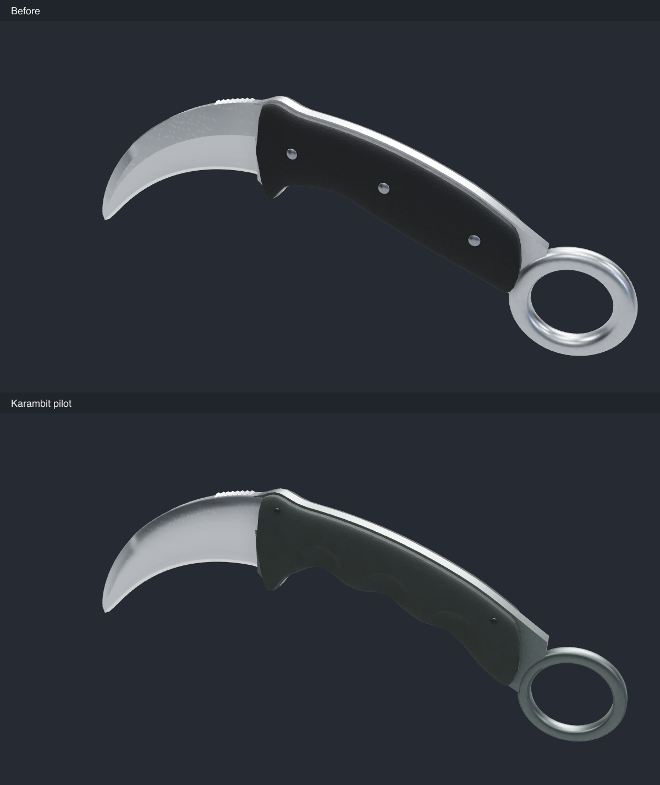

Validation: all 117 knife asset checks pass, including new geometry checks for
the three recesses and ring clearance. The full live grip/wrist sweep passes
4,891 frames across all 12 knives, with held attachments within 0.5 mm.
The new model was also rendered in desktop and mobile first-person views.

Still needed: align multiple reference views before changing blade proportions,
match the thumb and spine detailing, and compare steel/handle response under
matched lighting. The third-person rig still displays a hardcoded procedural
Bayonet, so it needs selected-knife integration before this pilot reaches remote
players. Do not describe this pass, the other eleven knives, or that remote path
as 1:1.

The dev preview accepts `model=<local-glb-path>` for comparisons and exposes
`window.__knifeModelPreview` for fixed-camera screenshots. The production view is
`/tools/knife-model-preview.html?knife=karambit&view=34&width=1200` on a local dev
server. To rebuild only this knife:

```bash
blender -b --factory-startup --python-exit-code 1 -P tools/blender/knives/build_knives.py -- karambit --out .blender-tmp/karambit-pilot
npx tsx tools/blender/knives/optimize_knives.ts .blender-tmp/karambit-pilot karambit
npm run test -- tools/assets/knives.test.ts
```

## Earlier CS2 fidelity review (2026-10-09)

These are visual approximations, not 1:1 CS2 models. This review did not change
the shipped meshes or import Valve assets.

Verified gaps:

- **Talon mechanism:** `build_knives.py:talon()` builds a folder with a tang,
  blade pivot and folding handle. The shipped GLB contains `blade_pivot` and
  `socket_pivot`, and `src/combat/knives.ts` also marks it as a folder. CS2's
  Talon is the fixed karambit-style model described on its official item page.
  Correcting it means changing geometry, sockets and deploy/inspect behavior
  together, not just hiding its opening animation.
- **Reference geometry:** profiles and dimensions were authored from related
  real knives. They have not passed an orthographic or matched-camera silhouette
  comparison against current CS2 knife references. Blade belly, tip angle,
  grind break, ring placement and handle proportions need separate checks.
- **Materials:** the checked Karambit, Talon, M9 and Butterfly GLBs already have
  tangent-space normals and ORM maps on all material slots. Their current files
  are approximately 1.31 MB, 0.52 MB, 1.00 MB and 0.54 MB. More pixels alone will
  not correct steel roughness, bevel shape or handle detail. Compare vanilla
  materials before evaluating painted finishes, wear and patterns.
- **Third person:** `src/multiplayer/playerRig.ts` still builds its knife
  template with `buildProceduralKnife`, not the shipped GLB LOD1. First-person
  and lobby model improvements would not automatically reach that path.

Reference availability:

- [Valve Workshop resources](https://www.counter-strike.net/workshop/workshopresources)
  links the newer `cs2_weapon_model_geometry.zip` and legacy
  `workbench_materials.zip`. Both were inspected in temporary storage; neither
  contained knife models. They are not a source for a complete knife remake.
- The [official Talon item page](https://steamcommunity.com/market/listings/730/%E2%98%85%20Talon%20Knife)
  is useful for its visible shape and material description. A market image is
  not enough to reproduce its underside, cross section or animation pivots.
- Public Workshop downloads are not, by themselves, evidence of permission to
  redistribute Valve models or textures in a separate web game. Verify that
  permission before considering a direct asset port. None is established here.

Recommended next step: one Karambit pilot, followed by the Talon mechanism fix.
Collect current vanilla side, underside, back and close-up references with the
camera/FOV recorded. Make an A/B sheet against the existing model before baking
new assets. Match silhouette and cross section first, then handle construction
and material response. Review at actual first-person scale and on a neutral
turntable before applying finishes. Only extend the process to the other types
after that pilot meets the visual bar.

Acceptance gates: no claimed numeric match without aligned references; preserve
the knife contract, folding clearances and grip/wrist checks; include both LODs
and the remote-player path; retain current payload budgets or explicitly agree
on a measured performance tradeoff. Higher triangle counts are not proof of
fidelity.

Every model is original geometry built by
committed Blender scripts. The shipped assets contain no imported Valve or
Counter-Strike meshes, textures or screenshots. Each knife follows the
real-world knife CS2 patterned it on (listed below) plus CS2's published item
descriptions, the same way the firearms follow real guns. Textures are baked by
the build script from material-specific shaders, geometry-aware wear and the
credited CC0 roughness/scratch scans. No Valve texture is used.

The files follow [the knife asset contract](knife-contract.md). Each knife
ships as `<id>.glb` (LOD0, first person) and `<id>_lod1.glb` (about 40% of the
triangles and 512 px textures, for third person) with the same nodes, sockets
and hints.

## Rebuild

```bash
# the 12 shipped knives' raw glbs (lod0 and lod1) into .blender-tmp/knives, a few minutes on the M5 (texture bakes on the gpu)
blender -b --factory-startup --python-exit-code 1 -P tools/blender/knives/build_knives.py
# or a few: ... build_knives.py -- karambit talon [--no-bake] [--no-lod] [--quick]
npx tsx tools/blender/knives/optimize_knives.ts          # -> public/knives/<id>.glb (webp up to 2048) and <id>_lod1.glb (512)
npx vitest run tools/assets/knives.test.ts

# 2560x1440 close-ups: blender, and three.js through the game's loader and tone mapping
blender -b --factory-startup --python-exit-code 1 -P tools/blender/knives/render_knives.py -- \
    .blender-tmp/knives .blender-tmp/knives/hires hires --samples 64
#   /tools/knife-model-preview.html?knife=<id>&view=34|side|back|handle|blade&lod=1&finish=<id> on the dev server

# preview sheets (tiles at one scale, a few minutes at 48 samples on the M5)
blender -b --factory-startup --python-exit-code 1 -P tools/blender/knives/render_knives.py -- \
    .blender-tmp/knives .blender-tmp/knives/final side 34 folding closeups --samples 48
node tools/blender/weapons/compress_previews.mjs .blender-tmp/knives/final docs/screenshots/knives 1800
```

`--no-bake` exports plain materials (for geometry work, seconds instead of
minutes); `--quick` also skips LOD1 and writes a side and 3/4 render per knife
to `.blender-tmp/knives/quick/`.

## How they are built

`tools/blender/knives/klib.py` holds the knife helpers on top of
`weapons/wlib.py`; `build_knives.py` has one function per knife.

- **Frame.** Everything is authored in millimetres in the contract frame: +X
  from the guard to the tip, +Y spine, the edge faces -Y, Z is thickness. The
  origin is the front of the handle on the edge heel line, so the blade spans
  about `y = 0` (edge) to `y = bladeHeight` (spine) at the heel, like the old
  procedural knives. Blender's axes stand in for the knife frame while
  building; `assemble()` turns the meshes +90 degrees about X so the glTF y-up
  conversion lands them back in knife axes.
- **Blades** are real cross sections (`klib.blade()`): stations run from the
  heel to the tip along the edge and spine curves (paired by arc length, with
  an extra station on every corner so tanto breaks and clip corners stay
  crisp). Each station spans edge to spine with rows for the polished
  secondary bevel (`knife_edge`), the primary grind (flat, or hollow and
  concave), the flats, and either a swedge or a mirrored second edge. The
  grind plunges in over the ricasso, the spine tapers toward the tip, and the
  point closes in every direction. Grind lines are sharp edges, the rest is
  smooth. Fullers are part of the section.
- **Features cut or added:** sawback teeth sit on the spine (0.92 of the local,
  tapered spine thickness, so they never stand proud of the flats); gut hooks
  and line cutters are exact booleans with a V-shaped cutter so the inside of
  the hook is a sharp `knife_edge`; the M9 wire-cutter hole, the talon's thumb
  hole, the kukri's cho and the skeleton's windows are booleans too.
- **Handles** are lofted superellipse sections (moulded grips, ribbed and
  grooved grips, pommels), domed scales on liners (`klib.slab()`), 2D outlines
  with fillets and bevels (guards, bolsters, clips), lathes (rings, pins,
  screws, pommels) and tubes (paracord wrap, lanyards).
- **Folders** get their pivot height from `fit_pivot()`: rotating the blade by
  -PI maps a blade point to `(2px - x, 2py - y)`, so it picks the highest pin
  that keeps the closed edge under the handle's spine line and the closed spine
  above the handle's bottom at every x. The backspacer is then carved to clear
  the closed edge (`back_line()`). The closed tang and any flipper tab stick out
  at the pivot end, as on the real knives.
- **Resolution for the viewmodel.** A knife can fill half of a 1440p screen, so
  curves get a point every 1.1 mm (`CURVE_STEP`), blades twice the stations
  (hollow grinds five rows), round sections, rings, pins and lathes 1.8 times
  the segments, fillets up to ten segments per corner. Scales are domed with
  rows packed toward the edges and a rounded 0.3 to 0.45 mm edge; guards,
  bolsters, tangs and clips are bevelled with hardened normals; the blade's
  spine is eased by a 0.4 mm chamfer row. Grind lines, the edge bevel and
  swedges stay crisp on purpose.
- **Materials** are the five contract names, split into three texture sets:
  steel (`knife_blade`, `knife_edge`), handle (`knife_handle`) and fittings
  (`knife_metal`, `knife_accent`). Each set has its own 0..1 UV atlas in UV0
  (`kbake.unwrap()`: smart project of that set's faces across every mesh,
  packed) and three images: base colour, a tangent-space normal map and an ORM
  map (glTF occlusion in R, roughness in G, metalness in B). Materials read the
  maps at factor 1. The blade's normal map is on `knife_blade` as its
  `normalTexture`, so the finish system can keep it when it swaps the colour.
- **Baked detail** (`kbake.py`). Each material's bake source is a Cycles shader
  combining credited CC0 roughness/scratch inputs with height fields and colour: satin grain on
  the steel, a finer polish on the edge, bead blast on fittings, fine G10 weave
  and fibres, pebbled rubber, diamond checkering on the M9, flowing wood grain
  with figure and pores, ivory grain, a woven paracord sheath, crepe grip tape.
  Cycles bakes it onto the game mesh as the normal map, bakes ambient
  occlusion from the real geometry (screws in their counterbores, pins,
  guards against grips, teeth, windows, rings; 1 cm distance, 48 samples),
  roughness, metalness and base colour. Handle normal maps are 2048 px
  (1024 for the M9's checkering and the paracord, whose regular patterns
  already hold at 1024 and cost four times as much at 2048 after WebP);
  everything else is 1024. Vertex colours are gone; AO is in the ORM.
- **LOD1** is a collapse decimation to 40% of every mesh (UV seams and
  material borders kept), exported with the same nodes; the optimizer takes
  its textures down to 512 px.

## Nodes and hints

| node | knives | notes |
|---|---|---|
| `<id>` | all | root; carries the userData hints |
| `body` | all | every static part (and the blade on fixed knives) |
| `blade_pivot` + `blade_pivot_mesh` | flip, stiletto; retired falchion, navaja, ursus, nomad builders | empty on the pin, `rotation.z` 0 open, -PI closed |
| `handle_safe` / `handle_bite` + `_mesh` | butterfly | empties on the spine-side and edge-side tang pins |
| `socket_grip` | all | centre of a hammer-grip fist, identity rotation |
| `socket_tip` | all | blade point; child of `blade_pivot` on folders |
| `socket_pivot` | folders | pin, same place as `blade_pivot` |
| `socket_pivot_safe` / `_bite` | butterfly | the two tang pins |
| `socket_ring` | karambit, talon, skeleton | ring centre; local +Z is the knife's +Z, the axis a finger goes through |
| `socket_tee` | shadow_daggers | centre of the T-bar, rotated -90 degrees about X so local +Z runs along the bar (knife +Y) |

The Skeleton has a front finger ring but keeps `grip: hammer` for its normal hold;
the ring socket is used by its spin and inspect poses.
For the push daggers the handle hints are measured on the bar:
`handleLength` is the bar length (along Y, the span the fingers wrap),
`handleHeight` its depth along X and `handleThickness` its thickness along Z.
On every other knife `handleLength` runs from the origin to the butt (to the
start of the ring on ring knives), `handleHeight` is across Y at the grip and
`handleThickness` across Z. `bladeLength` is the blade's reach along +X (so
`u = x / bladeLength` is 0 to 1 over the blade); on the hawkbills the point
itself sits a little short of it and lower. `bladeHeight` is the widest
spine-to-edge distance.

### Sockets

Positions in millimetres in the knife frame (three.js axes). All sockets and
pivots have z = 0. The rebuilt tips, Talon ring and Skeleton ring are deliberate
contract updates; grip anchors remain stable. `tools/assets/knives.test.ts` pins
these values within 1 mm, with live grip checks validating the resulting fit.

| knife | `socket_grip` | `socket_tip` | pivots | `socket_ring` |
|---|---|---|---|---|
| bayonet | -62, 18 | 200, 24 |  |  |
| m9_bayonet | -63, 19 | 190, 22 |  |  |
| karambit | -43, 6.3 | 97.2, -41.36 |  | -99.8, -22.4 (inner r 11.5) |
| butterfly | -64, 11.5 | 102, 16.36 | safe -6.5, 18.2; bite -6.5, 4.7 |  |
| flip | -62, 14.5 | 100, 34 | -9, 15.07 |  |
| gut | -58, 16 | 120, 40 |  |  |
| huntsman | -62, 19 | 155, 36 |  |  |
| falchion | -66, 13.8 | 128, 30 | -8, 14.7 |  |
| shadow_daggers | -24, 13 | 78, 13 | tee -24, 13 |  |
| bowie | -60, 20 | 210, 35 |  |  |
| navaja | -62, 9.4 | 105, 13 | -8, 9.5 |  |
| stiletto | -70, 8 | 125, 8 | -11, 8.7 |  |
| talon | -42, 7.9 | 96.19, -40.88 |  | -96, -29 (inner r 11.5) |
| ursus | -62, 16 | 108, 16.5 | -9, 17.1 |  |
| classic | -63, 19 | 200, 17 |  |  |
| paracord | -52, 16 | 130, 19.5 |  |  |
| survival | -66, 17 | 130, 13 |  |  |
| nomad | -62, 15.5 | 104, 20 | -8, 15.8 |  |
| skeleton | -44, 14 | 140, 14 |  | -17, 14 (inner r 11) |
| kukri | -62, 17 | 250, -14 |  |  |

### Budgets

LOD0 is at most 15,000 triangles and 1.5 MB, LOD1 at most 400 KB with under
half the triangles. "handle px" is the handle normal map's size.

| knife | LOD0 tris | handle px | LOD0 textures | LOD0 file | LOD1 tris | LOD1 textures | LOD1 file |
|---|---:|---:|---:|---:|---:|---:|---:|
| bayonet | 10,262 | 2048 | 822 KB | 915 KB | 4,104 | 198 KB | 248 KB |
| flip | 14,170 | 2048 | 1100 KB | 1255 KB | 5,666 | 88 KB | 171 KB |
| gut | 7,326 | 2048 | 568 KB | 651 KB | 2,930 | 115 KB | 161 KB |
| karambit | 11,676 | 2048 | 914 KB | 1035 KB | 4,670 | 111 KB | 175 KB |
| m9_bayonet | 12,604 | 1024 | 856 KB | 979 KB | 5,040 | 209 KB | 272 KB |
| huntsman | 9,132 | 2048 | 1147 KB | 1246 KB | 3,652 | 102 KB | 157 KB |
| butterfly | 14,876 | 1024 | 303 KB | 481 KB | 5,950 | 87 KB | 174 KB |
| falchion | 12,996 | 2048 | 1289 KB | 1437 KB | 5,198 | 81 KB | 160 KB |
| shadow_daggers | 4,490 | 2048 | 153 KB | 212 KB | 1,796 | 54 KB | 88 KB |
| bowie | 10,482 | 2048 | 1147 KB | 1253 KB | 4,192 | 106 KB | 166 KB |
| navaja | 10,920 | 2048 | 610 KB | 733 KB | 4,366 | 93 KB | 161 KB |
| stiletto | 11,218 | 2048 | 551 KB | 680 KB | 4,486 | 103 KB | 173 KB |
| talon | 14,682 | 2048 | 369 KB | 522 KB | 5,872 | 117 KB | 196 KB |
| ursus | 10,838 | 2048 | 1390 KB | 1517 KB | 4,334 | 92 KB | 161 KB |
| classic | 9,396 | 2048 | 997 KB | 1087 KB | 3,758 | 110 KB | 158 KB |
| paracord | 6,248 | 1024 | 930 KB | 1014 KB | 2,498 | 319 KB | 376 KB |
| survival | 7,614 | 2048 | 1311 KB | 1389 KB | 3,044 | 125 KB | 169 KB |
| nomad | 11,954 | 2048 | 1339 KB | 1477 KB | 4,780 | 94 KB | 168 KB |
| skeleton | 10,672 | 2048 | 610 KB | 711 KB | 4,268 | 106 KB | 159 KB |
| kukri | 8,402 | 2048 | 753 KB | 830 KB | 3,360 | 93 KB | 136 KB |

Folder tips are given open; closed, a tip lands at `(2px - x, 2py - y)`.

Close-ups at 2560x1440 (stored at 1280 px) of every knife in Blender are in
`docs/screenshots/knives/hq/blender_<id>.png`. The same models in three.js,
through the game's loader, lights and ACES tone mapping
(`tools/knife-model-preview.html`), plus LOD1 and two finishes:

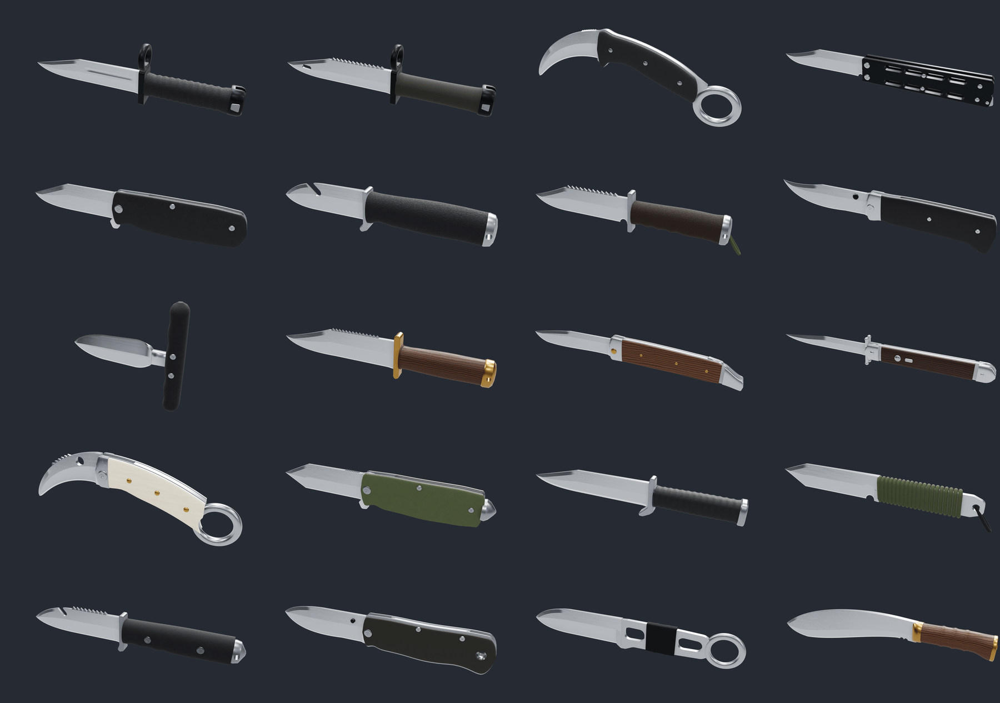
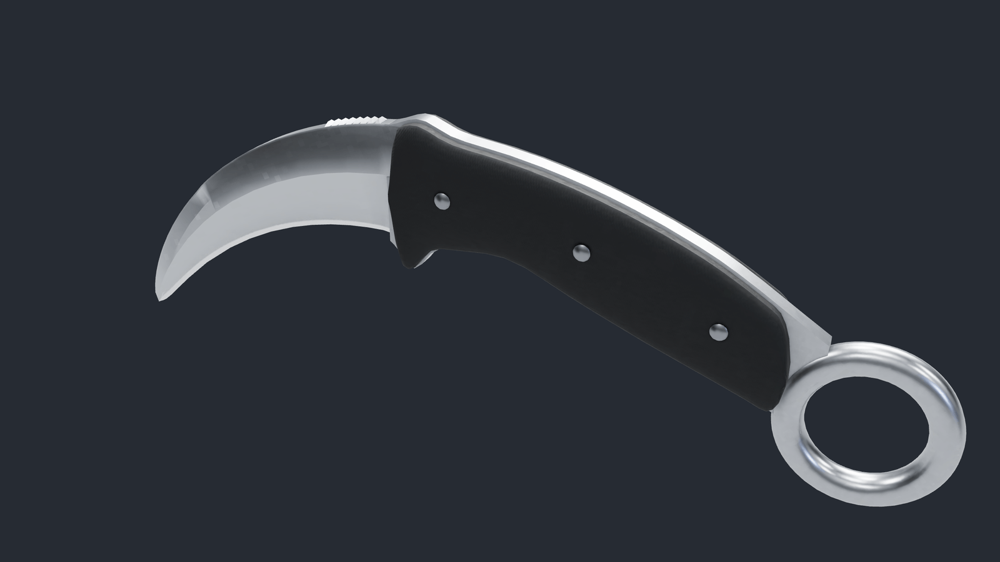
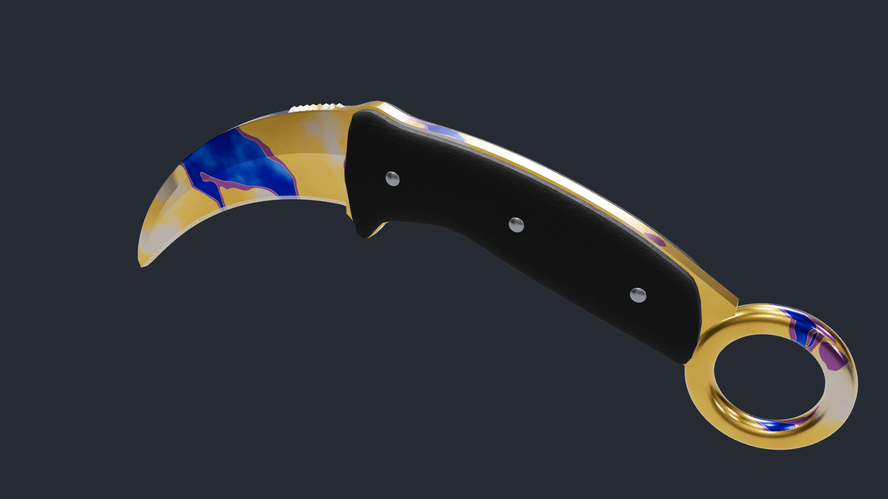
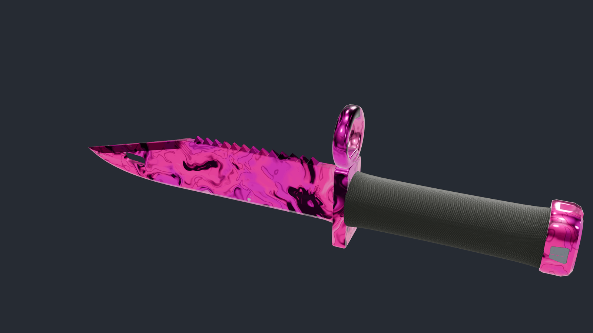

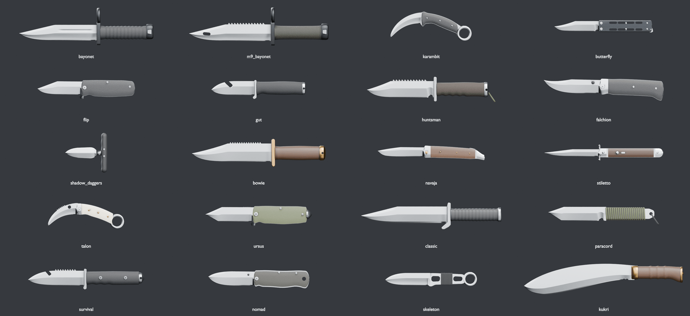
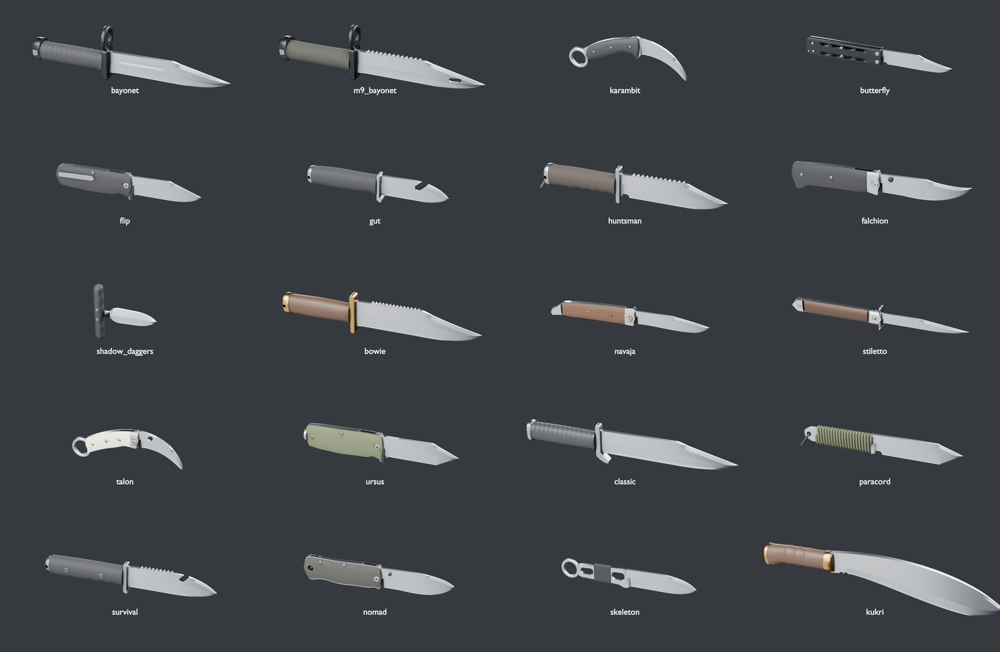
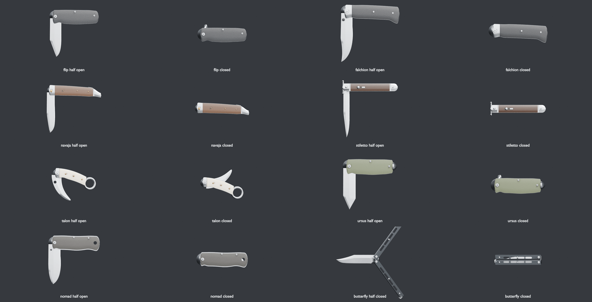

## Grips in the game

`tools/assets/gripFit.ts` fits each knife's finger curls offline and writes
`src/viewmodel/knifeHandPoses.json`. The running game is the authority though:

```bash
# every knife through idle, draw, slashes, stab, backstab and inspect, live finger
# bones against the live knife meshes (both hands on the push daggers)
GPU=1 node tools/qa/grip-check.mjs http://<lan ip>:5173 report.json
STEP=0.00833 GPU=1 node tools/qa/grip-check.mjs ...      # every clip at 1/120 s
BYPASS_FILE=~/.config/webstrafe/vercel-bypass.txt ...    # against a vercel preview
# refit in the game when a knife fails: finger curls, and the thumb's way to an opener
node tools/qa/grip-tune.mjs http://<lan ip>:5173 karambit middle,ring
node tools/qa/grip-tune-opener.mjs http://<lan ip>:5173 stiletto
```

The check also measures attachment: the knife's grip socket, on the part the
hand holds (a balisong's bite handle), must stay within 5 mm of where the hand's
grip puts it. Only two moments are allowed off the hand, each bounded and
reported: the toss inspect, and the skeleton's hand moving between its handle
and its ring (a finger stays on the knife once the ring is on it).

The tuners print `engine`, `opener` and `openerVia` entries for the pose table;
`gripFit.ts` keeps them when it's rerun. The push daggers' t-grip is authored
in `knifeGrips.ts` (the rig can't spread fingers in the fitter). Close-ups from
the first person camera for every knife are in
`docs/screenshots/knives/grips/ingame/`.

## Knife by knife

Real-world counterparts come from
[the Steam guide "Real Knives of Counter-Strike"](https://steamcommunity.com/sharedfiles/filedetails/?id=2227368716)
unless noted, cross-checked with the
[Counter-Strike wiki](https://counterstrike.fandom.com/wiki/Knife) item
descriptions and
[BladeForums' list](https://www.bladeforums.com/threads/real-versions-of-game-csgo-knives-not-replicas.1791413/).

- **bayonet** (Buck M9, 1991 USMC pattern): 180 mm blade, 36 mm tall, 5.8 mm,
  hollow ground with a long straight false edge into a spear-like clip point,
  a fuller, no saw teeth (that is what separates it from CS2's M9). Black
  oxide crossguard with the muzzle ring over the spine sized for a 22 mm NATO
  flash hider, ring-grooved grip, pommel with the lug slot opening at the butt
  and the two lock-release levers.
  Sources: [M9 bayonet](https://en.wikipedia.org/wiki/M9_bayonet),
  [Phrobis M9A1 trials spec](https://mocityman.com/content/M9Resources/PhrobisM9A1USMCTrialsSpecs.compressed.pdf)
  (7.125 x 1.4375 x 0.23 in blade, 22 mm flash hider, bottle openers),
  [TM 9-1005-237-23&P](https://m9bayonet.com/library/TM9-1005-237-23P.pdf) (left and right release levers),
  [SARCO's M9 notes](https://www.sarcoinc.com/blog/pretty-much-everything-you-wanted-to-know-about-the-m9-bayonet).
- **m9_bayonet** (Smith & Wesson SW3G style M9 with the big backsaw): 190 mm
  clip point, 13 large saw teeth on the spine, the oval wire-cutter hole 1.6 in
  behind the tip, same guard and ring, round knurled grip (generated diamond
  checkering), pommel with lug slot and levers.
  Sources: the M9 patent [US5594967A](https://patents.google.com/patent/US5594967A/en)
  ("an oval wire cutter pivot hole ... about 1-2 inches behind the tip"), the
  trials spec above (2.82 in saw).
- **karambit** (United Cutlery Honshu karambit): hawkbill blade on an 80 mm
  arc, hollow grind with a swedge near the point, jimping, curved full-tang
  handle with a finger-guard hump and thumb rest, a finger groove, scales on a
  steel tang, and the ring at the butt: 23 mm inside diameter (a gloved index
  finger; common rings run 20 to 25.4 mm).
  Sources: [BladeForums on karambit ring size](https://www.bladeforums.com/threads/combat-karambit-finger-hole-width.658642/),
  [Kharma Gen.3X specs](https://www.tacticshop.com/en/kharma-gen3x-venom) (1 in ring),
  [ring size table](https://www.printables.com/model/1010104-tactical-combat-karambit).
- **butterfly** (Terry Guinn Gargoyle-style balisong): 102 mm curved clip point
  with a long concave swedge and a slight recurve, choil, tang with both pivot
  holes and a kicker. Two channel handles with their backs on the grip's
  centre line, so the channels face out when open and wrap the blade when
  closed; drilled walls like the milled titanium originals, pivot screws on
  both pins, zen screws, and the latch on the bite handle.
  Sources: [Squid Industries anatomy](https://www.squidindustries.co/blogs/education-squid-industries/balisong-anatomy),
  [balisong anatomy](https://balisongbutterfly.com/balisong-anatomy-parts-explained)
  (bite handle on the edge side, latch on the bite handle),
  [Benchmade anatomy](https://support.benchmade.com/hc/en-us/articles/24423264139035-Balisong-Anatomy),
  [Gargoyle V2 listing](https://www.pacificedgecutlery.com/balisongs/terry-guinn-gargoyle-v2-gg-019-hybrid-scimitar-recurve/),
  [Gargoyle series thread](https://knifedogs.com/threads/terry-guinn-gargoyle-balisong.45771/).
- **flip** (Benchmade Bedlam 860, simplified the way CS2 does): 100 mm broad
  blade with an angular swedge break (the "tanto-ish" line) and an upswept
  belly, flipper tab that becomes a finger guard when open, G10 scales on
  steel liners, backspacer, torx pivot and screws, tip-up pocket clip on the
  +Z side (first person sees -Z).
  Source: [Bedlam 860 specs](https://www.gpknives.com/benchmade-bedlam-860-satin-plain-edge-g10-knife.html).
- **gut** (Buck 193 Alpha Hunter): 100 mm drop point, the gut hook cut into the
  dropping spine with its lip overhanging toward the handle and a sharpened
  V inside, small steel guard with a forward hook, pebbled rubber grip with a
  finger groove, steel butt cap with a lanyard hole.
  Source: [Steam guide (2015)](https://steamcommunity.com/sharedfiles/filedetails/?id=396248292).
- **huntsman** (MTech Xtreme MX-8054, itself a copy of the DiAlex H.E.C.K.):
  155 mm clip point with a concave swedge, 12 saw teeth, a finger choil at the
  heel, steel double guard, four finger grooves in the rubber grip, pommel
  with a lanyard loop.
  Source: [CS wiki](https://counterstrike.fandom.com/wiki/Huntsman_Knife).
- **falchion** (Cold Steel Espada): folder with a falchion-like blade whose belly
  sweeps up to a point level with the spine after a concave clip, polished
  bolsters, G10 scales, a curved pistol-grip handle with the hooked butt,
  thumb disc.
  Sources: [Espada Large specs](https://www.bladehq.com/item--Cold-Steel-Espada-Large-Lockback--31766),
  [KnifeCenter](https://www.knifecenter.com/item/CS62MB/cold-steel-62mb-large-espada-folding-knife-s35vn-satin-blade-polished-g10-handles-with-aluminum-bolsters).
- **shadow_daggers** (Gerber Uppercut push dagger): 66 mm double-edged spear
  with a diamond section, a narrow stem that passes between the middle and ring
  fingers, and the T-bar across the palm in the blade's plane with four finger
  grooves on the blade side. One dagger per file, `pair: true`.
- **bowie** (Aitor Oso Negro): 185 mm clip point with a deep belly, a concave
  swedge and a sawback (CS2: "full-tang sawback Bowie"), brass guard and
  pommel, wood-look handle.
  Sources: [Aitor](https://knivesaitor.com/en/product/oso-negro/) (185 mm,
  double saw, brass guard and pommel), [CS wiki](https://counterstrike.fandom.com/wiki/Bowie_Knife).
- **navaja** (Emerson Gypsy Jack custom, a modern navaja): slim 105 mm clip
  point with a recurve, curved handle tapering into a downturned tail, metal
  front bolster and tail cap, wood scales with brass pins, the back spring and
  its lock lever on the spine.
  Sources: [Navaja](https://en.wikipedia.org/wiki/Navaja),
  [Gypsy Jack specs](https://knifecritic.com/product/emerson-gypsy-jack).
- **stiletto** (Frank Beltrame 11 in Italian stiletto): 125 mm bayonet blade,
  flat grind on the edge side and a long swedge (the false edge) on the spine,
  swinging open around `blade_pivot` like a side-opening switchblade. Front and
  rear bolsters, quillons with ball ends split either side of the blade slot,
  wood scales, the push button and the sliding safety on the show side, the
  back spring along the spine.
  Sources: [stiletto mechanism](https://stiletto-italiano.com/eng/stilettoscheme.htm),
  [AKC 9 in specs](https://www.bladehq.com/item--AKC-Swinguard-9-Auto-Italian--189012),
  [swivel bolster release](https://knivesatlanta.com/akc-italy-9-stag-bayonet-swivel-release-stiletto/).
- **talon** (Kiaslore Tiger Claw with ivory scales): folding hawkbill with
  saw-tooth ridges on the spine and a thumb hole, ivory scales with brass
  rivets (CS2: "ivory-handled karambit features brass rivets and saw-tooth
  ridges"), steel bolsters and liners, and the steel ring at the butt, 23 mm
  inside.
  Source: [CS wiki](https://counterstrike.fandom.com/wiki/Talon_Knife).
- **ursus** (Gerber Prodigy tanto): tanto-style faceted blade with jimping,
  military green G10, impact pommel. Built as a folder because the contract
  lists it with the folders (see below).
  Source: [CS wiki](https://counterstrike.fandom.com/wiki/Ursus_Knife).
- **classic** (Mick Strider's Badlands Bowie, the CS 1.6 and Source knife):
  200 mm clip point, a wide polished edge band after the original's
  press-fit Stellite edge, a guard whose lower quillon sweeps forward, a ribbed
  handle and a flat pommel.
  Source: [CS wiki](https://counterstrike.fandom.com/wiki/Classic_Knife).
- **paracord** (Linton Seal Tactical / TOPS SWAT Spike tanto type): 130 mm
  clipped tanto with a swedge and a finger choil, the tang wrapped in olive
  paracord (a real helix over a braid normal map), the exposed tang end with
  a lanyard hole and a black cord loop.
  Sources: [CS wiki](https://counterstrike.fandom.com/wiki/Paracord_Knife),
  [cs.money on the Shattered Web knives](https://cs.money/blog/cs-go-skins/500-days-without-new-knives/).
- **survival** (FKMD Navita dive / combat knife, and its Weyland copy): 130 mm
  drop point with a sawback, a line cutter (gut hook) on the spine, integral
  guard, finger-grooved composite handle held by two hex bolts, steel butt
  cap with a lanyard hole and a glass-breaker point.
  Sources: [CS wiki](https://counterstrike.fandom.com/wiki/Survival_Knife)
  ("serrated edge ... plus a sharp gutting hook. The composite material handle
  is bolted to the blade with hex nuts"),
  [FKMD Navita](https://medium.com/@bladebattalion/fkmd-navita-diving-combat-knife-e67eca5a1d27),
  [FKMD handle bolts](https://hardcorecampingtools.blogspot.com/search/label/FKMD).
- **nomad** ("Strider B46" type): lockback folder with a broad, curved blade
  and upswept point, ergonomic handle with a finger choil, composite inserts
  set in an exposed steel frame, the lock bar along the spine, thumb stud and
  a lined lanyard hole at the butt.
  Source: [CS wiki](https://counterstrike.fandom.com/wiki/Nomad_Knife)
  ("ergonomic tactical hunting lock-blade knife features composite handle
  inserts and a broad, sturdy blade").
- **skeleton** (HX Outdoors Q-03 / Renegade G4 Stryker type): one piece of
  steel, hollow-ground drop point, the skeletonized handle with two windows,
  grip tape between them, and the ring at the butt (22 mm inside).
  Source: [CS wiki](https://counterstrike.fandom.com/wiki/Skeleton_Knife)
  ("skeletonized-tang knife has been taped at the handle ... The hole allows a
  finger to be threaded through").
- **kukri** (Elk Ridge style handle, traditional Nepali blade): 250 mm blade
  that bends forward and down, widest (54 mm) at the belly, 8.5 mm spine
  tapering to about 3 mm, the "3"-shaped cho notch at the base of the edge,
  brass bolster, wood handle with three raised rings and a flared butt, flat
  butt cap with the tang peen.
  Sources: [Kukri](https://en.wikipedia.org/wiki/Khukri),
  [kukri terminology](https://everestforge.com/kukri-khukuri-terminology-guide),
  [KHHI booklet](https://www.thekhukurihouse.com/blog/kukri-knife-booklet).

Close-ups:

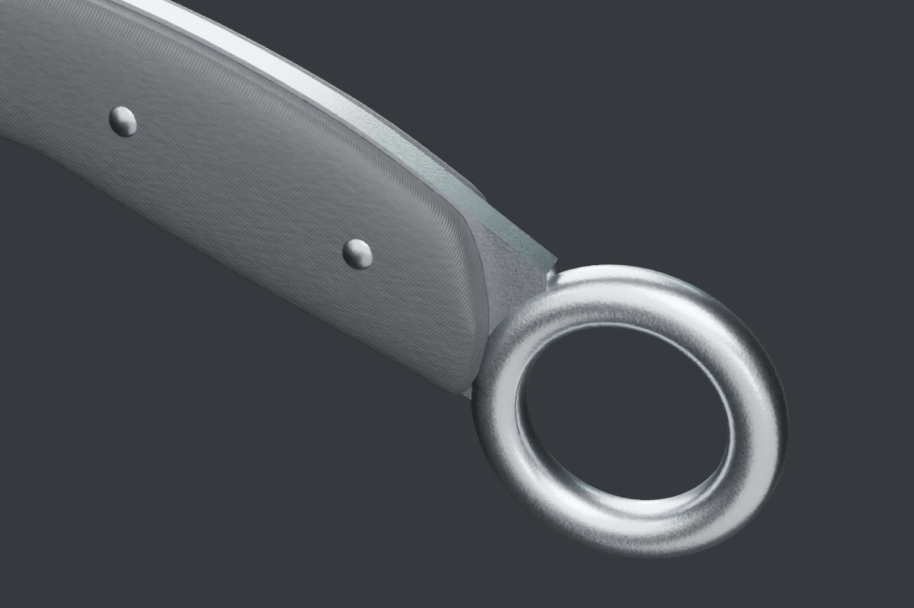
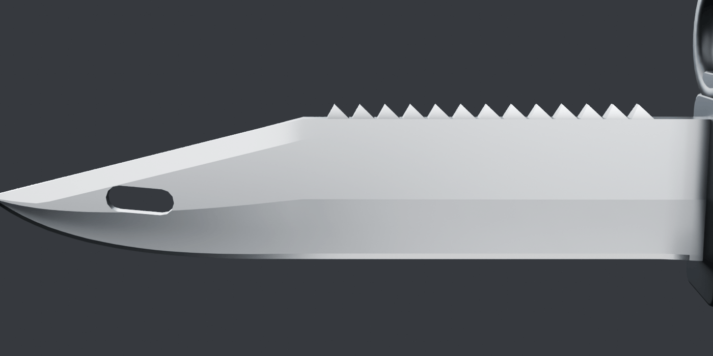
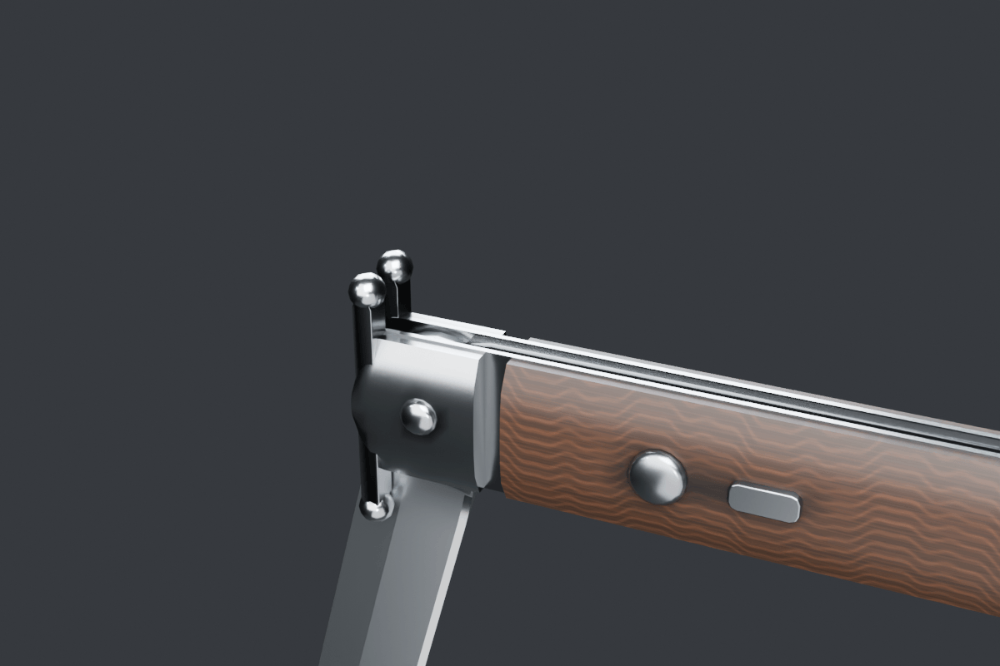
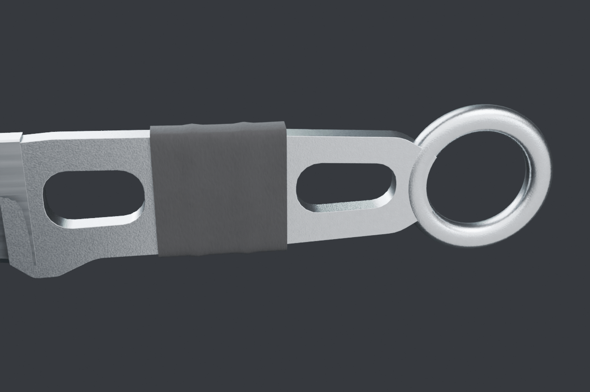

## Known deviations and simplifications

- **Ursus mechanism.** CS2's Ursus is a fixed blade ("No fuss, no moving
  parts"), but the contract lists it with the folders, so it ships with
  `blade_pivot` and folds. The blade is 108 mm instead of the Prodigy's
  120 mm so it can close inside the handle. Setting `URSUS_FOLDER = False` in
  `build_knives.py` makes it fixed; the contract and the viewmodel would need
  the same change.
- **Survival knife.** The references describe a bolted composite handle and a
  gutting hook (the FKMD Navita), not a hollow handle with a compass cap, so
  it follows the references.
- **M9 wire-cutter hole** sits near the tip (1-2 in behind it, per the
  patent), not near the guard. There is no hook on the blade; on the real M9
  the hooked lug is on the scabbard.
- **Sizes.** Real-world sizes, except where a counterpart is out of scale for
  the set: the classic is 200 mm (the Badlands Bowie is 254 mm), the kukri
  250 mm (a standard 10 in kukri; the Elk Ridge 13 in model is 330 mm), and
  the paracord 130 mm (the Linton listing says 250 mm).
- **Talon closed.** A hawkbill rotated by -PI curves the other way, so the
  closed talon's point stands out of the handle's spine. Real folding
  karambits curve the handle to match; the contract's single -PI hinge can't.
- **Balisong closed.** The handles close exactly around the blade, but the
  latch is modelled in its stowed position only.
- **Balisong swing direction (for the viewmodel).** The contract says
  `handle_safe` closes to +PI and `handle_bite` to -PI. With the safe handle on
  the spine-side pin, a positive `rotation.z` (counter-clockwise seen from +Z)
  swings its butt down through the edge side, so with those signs the two
  handles pass through each other half way. -PI for `handle_safe` and +PI for
  `handle_bite` swing them round the spine and the edge without crossing. The
  closed pose is the same either way; the folding sheet shows the
  non-crossing direction.
- **Hidden mechanisms** (liner and back locks, detents, springs inside
  handles) are only shown where they are visible from outside.
- **Detail is baked from procedural height fields,** not from sculpted
  high-poly meshes. Everything with a silhouette (teeth, jimping, screws with
  torx and hex sockets, pivots, cut-outs, cord wraps) is real geometry; only
  surface texture lives in the normal maps.
